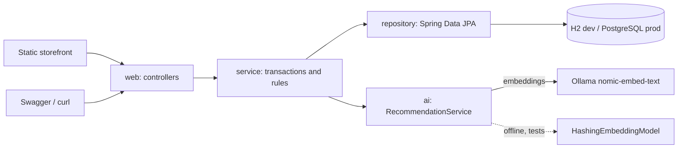

# How PageTurner was built with IBM Bob

**Repository:** https://github.com/harry99156/bookstore-backend
**Live demo (optional):** `<ADD RENDER URL HERE>` (see "Deploy to the cloud" in the [README](../README.md))

This document shows what Bob did, how it decided, and where to verify each claim in the code.

## 1. Bob capabilities used, with evidence

| Bob capability | What it did in this project | Where to verify |
|---|---|---|
| **Workspace understanding** | Inspected the toolchain (Java 21, Maven 3.9) and reused conventions from an existing Spring Boot project instead of guessing | `pom.xml`, package layout under `src/main/java/com/pageturner/bookstore` |
| **Planning with a todo list** | Split the work into scaffold, domain, services, API, ops, tests, verify and updated the list as steps finished | Order of the steps in section 2 |
| **Multi-file generation** | Produced entities, repositories, DTO records, services, controllers, error handling, OpenAPI config, seed data, Dockerfile, compose, CI and Render blueprint consistently | 49 files in the initial commit |
| **Run, read, fix loop** | Ran `mvn verify`, read a real failure, fixed the root cause, re-ran | Section 3, "Failure Bob fixed" |
| **Running the real artifact** | Started the packaged jar and drove it over HTTP: browse, cart, over-stock `409`, checkout, stock decrement | Section 2, step 5 |
| **Browser check** | Loaded the storefront in headless Edge against the running app and confirmed it rendered the live catalog | `StorefrontTest`, `static/index.html` |
| **Code reuse across projects** | Reused the LangChain4j/Ollama embedding setup from another workspace project for the AI feature | `ai/AiConfig.java`, `ai/RecommendationService.java` |
| **Self-review** | Caught its own defects: a Javadoc that promised restocking the code did not yet do, unused imports, a dead test line | `OrderService.cancel` now really restocks |

## 2. Development process

1. **Understand the environment.** Bob checked the JDK and Maven versions and an existing Spring Boot project before writing code.
2. **Plan.** A todo list drove the work: scaffold, domain, services, API, ops, tests, verify.
3. **Generate in layers.** Bottom up (`model`, `repository`, `service`, `web`) so each layer compiled against a finished one.
4. **Verify, don't assume.** `mvn verify` failed first, was fixed, and was re-run to green (section 3).
5. **Run the real artifact.** The jar was started and exercised over HTTP, not just through unit tests.
6. **Add the AI capability.** `GET /books/recommendations` ranks in-stock books by meaning (see section 4).
7. **Add a storefront.** One static page served by the same jar, no build tooling, covering every endpoint including the AI tab.
8. **Self-review.** Docs and code were compared and mismatches fixed.

The suite grew as features were added, from 7 tests (core API) to the current **18** (API end-to-end, recommendations, storefront, Postgres profile config).

## 3. Failure Bob fixed (the run, read, fix loop)

The first `mvn verify` failed with a `LazyInitializationException` while serialising a cart outside a Hibernate session. Bob read the stack trace, changed the fetch strategy, and re-ran until the tests passed. The result is visible in the entities: `Cart.items`, `CustomerOrder.items` and `CartItem.book` are `FetchType.EAGER`. Eager fetching is acceptable here because carts and orders are small and always returned together with their lines.

## 4. Architecture and design decisions

| Decision | Why | Alternative rejected |
|---|---|---|
| **Layered, controllers thin** | Rules and transactions live in one place (`service`) and are testable without HTTP | Logic in controllers |
| **DTO records separate from entities** | The API contract does not change when the schema does; no accidental lazy-loading during JSON serialisation | Returning JPA entities |
| **Atomic checkout** (`OrderService.checkout`, `@Transactional`) | Validate stock, decrement, save order, clear cart succeed or fail together | Separate calls per step, which can leave half-finished orders |
| **`@Version` optimistic locking on `Book`** | Two buyers racing for the last copy produce a `409` instead of a lost update and negative stock | Pessimistic locks, which cost throughput for a rare case |
| **`Book.decreaseStock` enforces the invariant** | The rule is in the domain object, so no caller can bypass it | Checks scattered in services |
| **`OrderItem` snapshots title and unit price** | Order history stays correct after a price change or book deletion | Joining to the live catalog |
| **Cancel restocks, tolerating deleted books** | Stock stays accurate; a deleted book does not break cancellation (`OrderService.cancel`) | Failing the cancel |
| **RFC 7807 `ProblemDetail` errors** | Standard, machine-readable errors: `400` with per-field errors, `404`, `409` | Ad hoc error JSON |
| **Embedding cache keyed by text hash** | An edited book re-embeds and a deleted one drops out with no coupling to the catalog write path | Re-embedding on every request, or invalidation hooks in `BookService` |
| **`503` only for the AI endpoint** | If Ollama is down, the shop keeps working | Letting an AI outage fail the whole API |
| **Offline `HashingEmbeddingModel`** (`bookstore.ai.embeddings=local`) | Tests and cloud demos run without Ollama; documented as keyword-level, not semantic | Requiring Ollama in CI |
| **Single static storefront, `textContent` only** | One jar serves UI and API; catalog data cannot inject HTML | A separate SPA with a build chain |
| **Config via env vars, `postgres` profile, multi-stage non-root Docker, health check, CI** | Deployable the same way locally, in compose and on Render | Hard-coded settings |

## 5. Honest limitations

- No authentication: catalog writes and order lookup are open (next step: Spring Security + JWT with an `ADMIN` role).
- No payments; checkout only creates the order.
- `ddl-auto=update` is for the demo; production should use Flyway.
- The cloud deployment has no Ollama, so the AI tab reports unavailable there unless `BOOKSTORE_AI_BASE_URL` points at a server (or `BOOKSTORE_AI_EMBEDDINGS=local` is set).

## 6. Video script (about 5 minutes)

Aim for process and reasoning, not just a tour of features. Keep the Bob chat panel visible for the first half.

| Time | Show on screen | Say |
|---|---|---|
| 0:00-0:30 | Bob chat with the original prompt; repo URL in the browser | The problem: an eCommerce bookstore backend. Bob works as an agent that plans, writes, runs and fixes, not just autocomplete. Repo link is in the description. |
| 0:30-1:10 | Bob's todo list and the project tree | How Bob planned: scaffold, domain, services, API, ops, tests, verify. Why layered: rules and transactions in one place. |
| 1:10-2:00 | `Book` (`@Version`, `decreaseStock`) then `OrderService.checkout` | The key design decision: checkout is one transaction and concurrent buyers hit optimistic locking, so no overselling. Order items snapshot price. |
| 2:00-2:50 | Terminal: failing `mvn verify`, the `LazyInitializationException`, Bob's fix, green run (18 tests) | This is the agentic loop. Bob ran the build, read the stack trace, found the root cause, changed the fetch strategy and re-ran. |
| 2:50-3:30 | Storefront at `/`: add to cart, checkout, stock drops; over-order to show the `409` message | Full stack from one jar. Bob also drove the running app over HTTP and loaded the page in headless Edge to verify it. |
| 3:30-4:15 | AI tab: "a story of wizards, dragons and a quest" returns The Hobbit first; show `RecommendationService` and the hash-keyed cache | Embeddings rank by meaning. Cache keyed by text hash keeps edits and deletes correct. If Ollama is down only this endpoint returns `503`. |
| 4:15-4:40 | Dockerfile, `docker-compose.yml`, `ci.yml`, `render.yaml` | Deployable locally, in compose and on Render, with CI on every push. |
| 4:40-5:00 | README "Known limitations" | What Bob and I would do next: auth, Flyway, payments. Bob's self-review caught its own Javadoc/code mismatch, so I trust but verify. |

### Checklist before submitting

- [ ] Replace the demo placeholder at the top of this file with the real Render URL (or delete that line).
- [ ] Put the same GitHub URL in the video description and the submission form.
- [ ] Show the Bob chat (prompt, todo list, the failing then passing build) on screen, not only the finished app.
- [ ] State at least three design decisions out loud with their reason (section 4).
